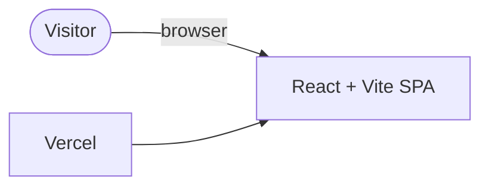
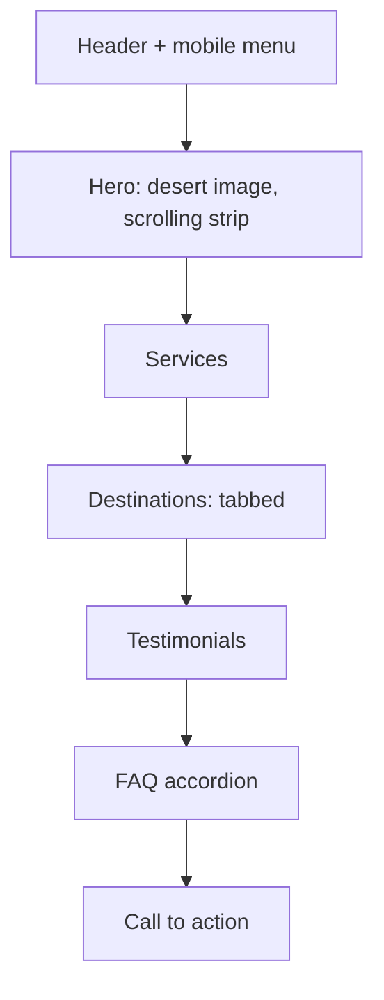

# Auravel Clone: High-Level Design

A pixel-faithful, fully responsive clone of the Auravel travel website, built in 48 hours for the breakoutAI frontend intern assessment. Live at [auravel-clone-five.vercel.app](https://auravel-clone-five.vercel.app). For code-level detail see the [Low-Level Design](lld.md).

## 1. Context

A front-end-only single-page site: no backend or API calls.

## 2. Page structure

## 3. Tech

| Item | Choice |
|---|---|
| UI | React 18, TypeScript, Vite |
| Styling | Tailwind CSS + tailwindcss-animate, shadcn/ui (Radix) components |
| Routing | React Router (`/` and a 404 page) |
| Hosting | Vercel |

## 4. Goals of the assessment

| Goal | How it is met |
|---|---|
| Pixel-perfect match | Same layout, imagery and typography as the original |
| Full responsiveness | Tailwind breakpoints and a mobile header menu |
| Original animations | CSS keyframes (40 s infinite scroll strip) and component transitions |
