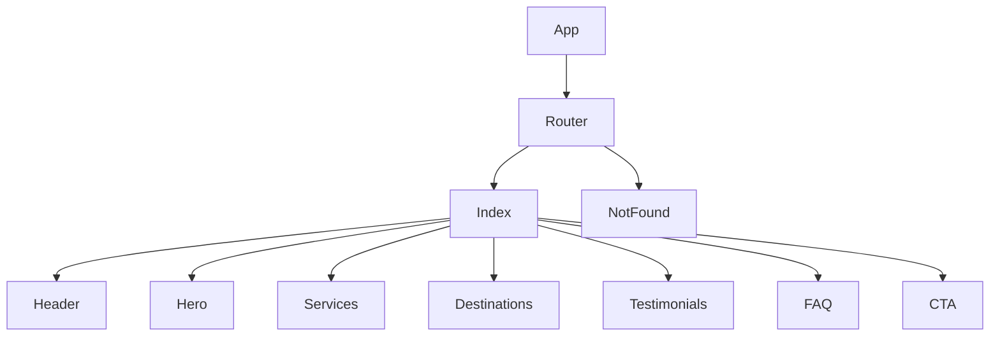

# Auravel Clone: Low-Level Design

For the big picture see the [High-Level Design](hld.md).

## 1. Source layout

| Path | Role |
|---|---|
| `src/main.tsx`, `src/App.tsx` | Mount, providers (React Query, tooltips, toasters), routes `/` → `Index`, `*` → `NotFound` |
| `src/pages/Index.tsx` | Composes the sections in order |
| `src/components/*.tsx` | `Header`, `Hero`, `Services`, `Destinations`, `Testimonials`, `FAQ`, `CTA` |
| `src/components/ui/*` | shadcn/ui primitives (accordion, button, …) |
| `src/assets/` | Hero and destination images (Egypt, France, Greece, Maldives), logo |
| `src/hooks/use-mobile.tsx` | Mobile breakpoint detection |

## 2. Component state

| Component | State / behavior |
|---|---|
| `Header` | `useState(false)` for the mobile menu open / closed |
| `Hero` | `animate-scroll` strip driven by `@keyframes scroll` (40 s linear, infinite) |
| `Destinations` | `useState("greece")` for the selected destination tab |
| `FAQ` | shadcn `Accordion`, one question open at a time |

## 3. Render tree

## 4. Notes

Many shadcn/ui components and libraries from the starter template (charts, forms, carousel, date picker) are installed but unused by the page and could be removed to shrink the bundle.
